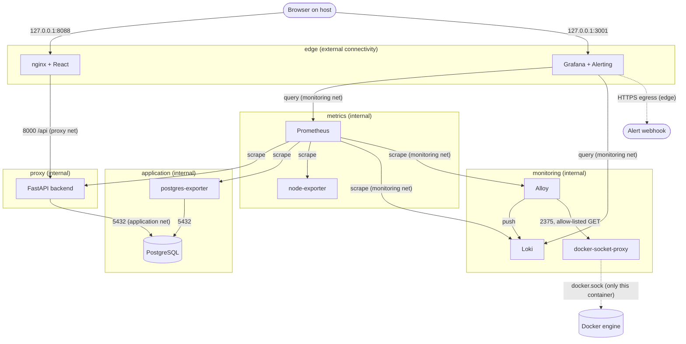

# Architecture

## Overview

A 3-tier Tasks application (React / FastAPI / PostgreSQL) with a centralized
observability stack (Prometheus, Loki, Alloy, Grafana). Everything runs under
Docker Compose on five segmented Docker networks (`edge` plus four internal
networks). The Compose file currently defines the networks and PostgreSQL
(Phase 2), the backend (Phase 3), nginx with the React UI (Phase 4) and Prometheus with both
exporters (Phase 5), Grafana with three dashboards (Phase 6), and Loki, Alloy and the Docker
socket proxy with a Logs dashboard (Phase 7).

## Network architecture



The diagram groups each service under one network for readability. Multi-homed
services (nginx, grafana, backend, postgres-exporter, prometheus) are listed in
the membership tables below; for example the backend is on `proxy`,
`application` and `metrics`. The diagram shows
**intended** flows only; network sharing permits more (see "What is and is not
blocked").

### Networks and membership

| Network | `internal` | Members |
|---|---|---|
| `edge` | **no** | nginx, grafana |
| `proxy` | **yes** | nginx, backend |
| `application` | **yes** | backend, postgres, postgres-exporter |
| `metrics` | **yes** | prometheus, backend, node-exporter, postgres-exporter |
| `monitoring` | **yes** | prometheus, grafana, loki, alloy, docker-socket-proxy, prometheus-ui |
| `uiaccess` | **no** | prometheus-ui (only) |

Purpose: `edge` = host-published ports and Grafana's egress; `proxy` = the
only path from nginx to the backend; `application` = the data tier;
`metrics` = Prometheus scrape traffic; `monitoring` = log and dashboard
traffic between Prometheus, Grafana, Loki and Alloy; `uiaccess` = nothing but the Prometheus UI forwarder's
published port (Docker cannot publish a port from a container that is only on internal networks, so the
forwarder needs one non-internal network of its own, and Prometheus, nginx and Grafana never join it).

Per-service attachments:

| Service | Networks | Published port | Outbound internet |
|---|---|---|---|
| nginx | edge, proxy | 127.0.0.1:8088 | yes (via `edge`; not required) |
| grafana | edge, monitoring | 127.0.0.1:3001 | yes (via `edge`; required for webhooks) |
| prometheus-ui | uiaccess, monitoring | 127.0.0.1:9090 | yes (via `uiaccess`; not needed; holds no secrets) |
| backend | proxy, application, metrics | none | no |
| postgres | application | **none, never** | no |
| postgres-exporter | application, metrics | none | no |
| prometheus | metrics, monitoring | none | no |
| node-exporter | metrics | none | no |
| loki | monitoring | none | no |
| alloy | monitoring | none | no |
| docker-socket-proxy | monitoring | none | no |

> **Design history:** the first four-network layout needed nginx on
> `application` so it could reach the backend, which made `postgres:5432`
> reachable from nginx. The dedicated internal `proxy` network (decisions #21,
> #31) removes that: nginx and PostgreSQL no longer share any network.
> postgres-exporter is on `application` as well as `metrics`, because it must
> reach PostgreSQL (decisions #20).

### Docker network limitations (no directional firewall)

Docker bridge networks provide connectivity between **all members** of a
network, on **every port**, in **both directions**. They are not directional
per-service firewalls, and this design does **not** implement directional
firewall enforcement or a strict per-flow allow-list. What it does implement
is *segmentation*: services share a network only when some flow needs it, and
four of the five networks have no route to the outside world.

`internal: true` removes the default gateway, so containers whose networks
are all internal have no outbound internet access. It does not restrict
traffic between members of that network.

### Reachability by topology

Two services can talk (any port, both directions) iff they share a network.

| Service | Can reach (shared network) |
|---|---|
| nginx | grafana (edge); backend (proxy) |
| grafana | nginx (edge); prometheus, loki, alloy, docker-socket-proxy (monitoring) |
| backend | nginx (proxy); postgres, postgres-exporter (application); prometheus, node-exporter, postgres-exporter (metrics) |
| postgres | backend, postgres-exporter (application) |
| postgres-exporter | backend, postgres (application); prometheus, backend, node-exporter (metrics) |
| prometheus | backend, postgres-exporter, node-exporter (metrics); grafana, loki, alloy, docker-socket-proxy (monitoring) |
| node-exporter | prometheus, backend, postgres-exporter (metrics) |
| loki | prometheus, grafana, alloy, docker-socket-proxy (monitoring) |
| alloy | prometheus, grafana, loki, docker-socket-proxy (monitoring) |
| docker-socket-proxy | prometheus, grafana, loki, alloy (monitoring) |

### Intended traffic

| # | Source | Destination | Port / path | Network | Purpose |
|---|---|---|---|---|---|
| 1 | Browser (host) | nginx | 127.0.0.1:`FRONTEND_HOST_PORT` (default 8088) -> 8080 | published | UI. The image is nginx-unprivileged and listens on 8080 |
| 2 | nginx | backend | 8000, only `/api/v1/*` | proxy | API proxy (implemented; other paths are answered by nginx) |
| 3 | backend | postgres | 5432 | application | App queries (the only app-to-DB path) |
| 4 | postgres-exporter | postgres | 5432 | application | DB metrics (dedicated monitoring role) |
| 5 | prometheus | backend | 8000 `/metrics` | metrics | App metrics (implemented, verified) |
| 6 | prometheus | postgres-exporter | 9187 | metrics | DB metrics |
| 7 | prometheus | node-exporter | 9100 | metrics | Host/VM metrics |
| 8 | prometheus | loki | 3100 `/metrics` | monitoring | Loki self-metrics (implemented) |
| 9 | prometheus | alloy | 12345 `/metrics` | monitoring | Alloy self-metrics (implemented) |
| 10 | prometheus | prometheus | 9090 | monitoring | Self scrape |
| 11 | alloy | loki | 3100 `/loki/api/v1/push` | monitoring | Log shipping (implemented) |
| 12 | alloy | docker-socket-proxy | 2375: GET `containers/json`, `containers/<id>/json`, `containers/<id>/logs`, `networks`, `_ping` (HEAD `_ping`) | monitoring | Container discovery and log reading. Alloy has **no** socket mount. The proxy refuses every other call and every other client |
| 12b | docker-socket-proxy | Docker engine | `/var/run/docker.sock` (read-only bind mount; the only container that has it) | bind mount (not a network) | Allow-listed forwarding; see `security.md` |
| 13 | grafana | prometheus | 9090 | monitoring | Datasource, alert queries |
| 14 | grafana | loki | 3100 | monitoring | Datasource and the Logs dashboard (implemented); alert queries in Phase 8 |
| 15 | grafana | alert webhook | 443 (HTTPS) | edge (egress) | Alert notifications |
| 16 | Browser (host) | grafana | 127.0.0.1:`GRAFANA_HOST_PORT` (default 3001) -> 3000 | published | Dashboards (implemented; login required) |

Prometheus itself is **not** published. For its own web UI there is a minimal forwarder, `prometheus-ui`
(`alpine/socat`, TCP only): host `127.0.0.1:9090` -> `prometheus:9090` over `monitoring`. Flows: (17) Browser
(host) -> prometheus-ui at `127.0.0.1:9090` via the published port, (18) prometheus-ui -> prometheus 9090 over
`monitoring`. Grafana Explore remains the other way to run PromQL. The component diagram above omits the
forwarder.

**Host port conflicts (development machine):** other Docker projects already publish
`0.0.0.0:8080` and `0.0.0.0:3000` (and a local process listens on `127.0.0.1:3000`). The nginx
host port is therefore configurable (`FRONTEND_HOST_PORT`); Grafana's port needs the same
treatment: Grafana publishes on 3001 (approved). The nginx default is 8088 (approved).

### What is and is not blocked

Reliably achieved by topology:
- PostgreSQL has no published port and no outbound route.
- Only backend and postgres-exporter share a network with PostgreSQL. nginx
  shares no network with it.
- nginx can reach only the backend (via `proxy`) and Grafana (via `edge`).
- Loki, Alloy, Prometheus, node-exporter, postgres-exporter and PostgreSQL
  are unreachable from the host and from nginx, except where listed above
  (Grafana reaches Prometheus, Loki and Alloy).
- Only nginx and Grafana have internet egress.
- Loki, Alloy, Prometheus and all exporters have no internet egress.

**Not blocked** (possible by topology; not needed):
- **nginx -> backend on any port** (including `/metrics`; nginx config will
  only proxy `/api/*`, but that is configuration, not network enforcement).
- **backend -> nginx** on any port (reverse direction on `proxy`).
- **backend -> prometheus, node-exporter, postgres-exporter** on any port, and
  the reverse direction.
- **postgres -> backend, postgres-exporter** on any port (reverse direction).
- **grafana -> loki/prometheus/alloy on any port** (e.g. Prometheus admin or
  lifecycle endpoints if enabled; Loki has no auth by default).
- **grafana <-> nginx** on any port (shared `edge`).
- **Grafana and nginx -> any internet destination**, not only the webhook
  host. Docker does not filter egress per destination.
- **Docker API access** is no longer given to Alloy directly: only `docker-socket-proxy`
  mounts the socket and it refuses every client except Alloy (IP allow-list) and every call outside
  its allow-list. Other `monitoring` members (Prometheus, Grafana, Loki) can open a TCP connection to
  the proxy and are refused at the HTTP level (verified). The proxy and Alloy are still
  trusted components: see `security.md`.
- **Loki's API, including its delete endpoint, has no authentication** and is reachable by every
  `monitoring` member (Prometheus, Grafana, Alloy, the proxy), not by nginx, the backend, PostgreSQL or
  the exporters (verified).
- **Bridging services**: nginx (edge + proxy), Grafana (edge + monitoring),
  Prometheus (metrics + monitoring), postgres-exporter (application +
  metrics) and the backend (proxy + application + metrics) connect segments.
  Docker does not route between networks, but a compromised bridging
  container can reach both sides directly. The backend is the most
  connected: it reaches nginx, PostgreSQL, Prometheus and the exporters (but it
  has no egress and no route to Grafana, Loki or Alloy). nginx and Grafana are
  the only containers with internet egress, and they share `edge`.

### Grafana webhook egress requirements

Grafana is the only observability component with internet access, via `edge`.

- **Destination:** the webhook/SMTP/Slack host(s) you configure for the
  contact point. Default is a placeholder webhook URL via env var.
- **Protocol / port:** outbound HTTPS 443 (or SMTP 587 if email is chosen).
  DNS resolution is also required.
- **Path:** Grafana container -> `edge` bridge -> Docker host NAT -> internet.
  If the destination is a service on the same machine, it must be reached via
  the host gateway name, and is not blocked by anything in this design.
- **Not restricted to the webhook host.** Docker cannot filter destinations.
  To restrict, use a host firewall or an egress proxy (see below).
- **Disable everything else that phones home:** Grafana analytics, update
  checks, plugin installs, the news feed and Grafana's own `/metrics` are turned off in
  configuration (Phase 6, implemented).
- Because Grafana also sits on `monitoring`, a compromised Grafana has both
  egress and a path to Prometheus, Loki and Alloy. Treat Grafana's admin
  credentials and datasource configuration as sensitive.

### Controls required for stricter isolation (not implemented)

| Control | Adds | Note |
|---|---|---|
| Host firewall (`DOCKER-USER` chain) | Per-source/port/direction rules, default-deny egress | Linux only; on Docker Desktop for Windows the rules would have to be applied inside the Docker VM, which is non-persistent and unsupported in practice |
| Egress proxy with destination allow-list | Limits Grafana to the webhook host | Adds a component; weigh against "no unnecessary technologies" |
| Authentication on Prometheus, Loki, exporters | Stops unauthenticated lateral calls | Prometheus `web.config.file`; Loki behind an authenticating proxy; disable Prometheus admin/lifecycle APIs |
| Per-container hardening (non-root, read-only rootfs, dropped caps) | Reduces compromise impact | Planned for Phase 9 |

### Windows / Docker Desktop limitations

- Containers run in a Linux VM. node-exporter reports the VM, not the Windows
  host. It must not use `network_mode: host` (that would bypass the network
  design); it will read `/proc`, `/sys` and `/` through read-only mounts.
- The Docker socket that the proxy mounts is the Docker Desktop VM's socket. There it is
  `root:root 0660`, so the proxy runs as `nobody` with group 0 added (`DOCKER_SOCKET_GID`; use the `docker`
  group id on Linux).
- `127.0.0.1` published ports are forwarded by Docker Desktop to the Windows
  loopback, and are not reachable from other machines.
- Host-level firewalling of container traffic (`DOCKER-USER`) is not
  practically available (see above).
- `internal` networks are enforced by the Docker engine in the VM, and behave
  the same as on Linux.

## Component responsibilities

| Component | Tier / role | Responsibility |
|---|---|---|
| Nginx + React | Presentation | Task UI; serves static build; proxies `/api/*` only; security headers |
| FastAPI | Application | CRUD API, `/health/live`, `/health/ready`, `/metrics`, JSON logs |
| PostgreSQL | Data | Persistent task storage (named volume) |
| Prometheus | Metrics | Scrapes targets, evaluates rules, bounded retention |
| node-exporter | Metrics | VM CPU, memory, disk, network |
| postgres-exporter | Metrics | Connections, transactions, locks, DB size |
| Loki | Logs | Log storage and LogQL queries |
| Alloy | Logs | Discovers this project's containers through the proxy, parses, labels and masks lines, ships them to Loki |
| docker-socket-proxy | Logs | The only holder of `docker.sock`; allow-listed read-only Docker API for Alloy |
| Grafana | Visualization / alerting | Provisioned datasources, dashboards, alert rules |

## Backend custom metrics (planned)

`http_requests_total`, `http_request_duration_seconds`,
`http_requests_in_progress`, `tasks_operations_total{operation}`,
`tasks_count{status}`, `db_query_duration_seconds`, `db_pool_connections`.

## Dashboards and alerts

Dashboards (implemented): Application, Host (Docker VM), PostgreSQL, Logs (Loki).
Alerts (Phase 8, planned): backend down, high 5xx rate, high p95 latency, Postgres down,
connection saturation, CPU / memory / disk pressure, error-log spike.

## Repository layout

```
frontend/    React + TS + Vite, Nginx config, Dockerfile
backend/     FastAPI app (api, core, db, schemas, services), Alembic, tests
monitoring/  prometheus, loki, alloy, grafana (provisioning + dashboards)
tests/e2e/   compose-level smoke tests
docs/        architecture, decisions, security
```
